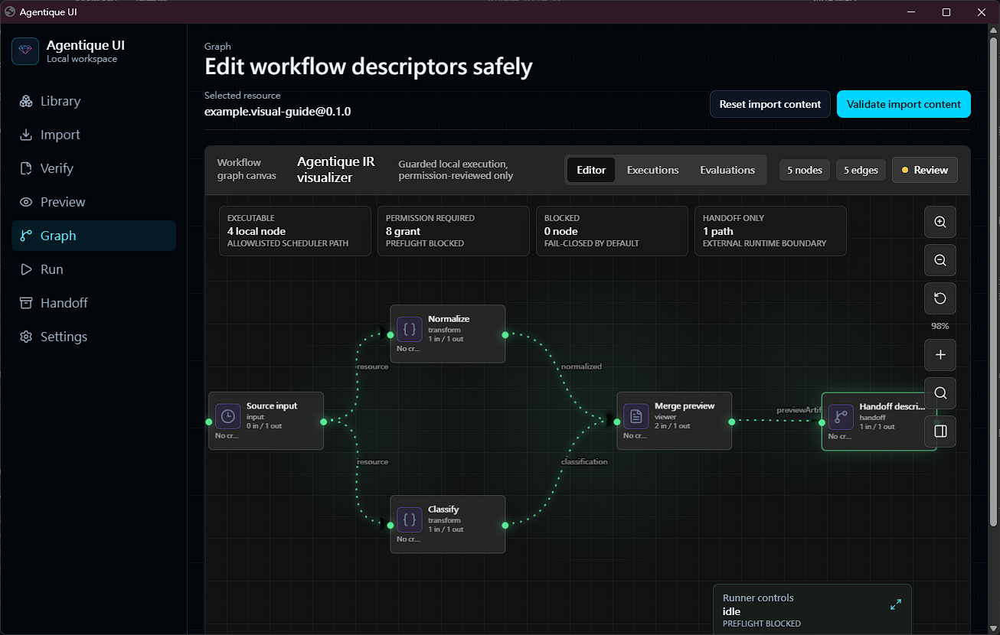

<p align="center">
  
</p>

# Agentique UI

Agentique UI is the local-first desktop workspace for Agentique resources. It helps users import, verify, inspect, preview, run supported local workflows, and hand off resources from [`agentique.io`](https://www.agentique.io) without turning the website into a hosted execution service.

## Last Update

<details>
<summary>View recent changes</summary>

- **Permission-owned native runs:** Explicit approval, one-use grants, cancellation, timeout, durable replay, redacted artifacts, and cleanup now run through the desktop boundary.
- **Local workflow orchestration:** Fixed Python and Node lanes plus deterministic DAG execution and checkpointed human approval are validated on Windows and Linux.
- **Checkpoint history:** Windows validation covers bounded immutable working-set history and fresh-approval retry, resume, and replay preparation.
- **Additional sandbox evidence:** One fixed in-process WebAssembly adapter is validated on Windows, and one optional fixed rootless-container adapter is validated on Linux. Neither expands the supported-local product claim.
- **Agent handoff protocol:** Capability-scoped bridge messages and host dispositions are validated without loading extension code or starting a network bridge.
- **Distribution integrity:** Real NSIS, MSI, deb, rpm, and AppImage packages were built locally and verified through the offline integrity boundary. They remain unsigned and unpublished, and macOS remains unsupported.

</details>

## Contents

- [Last Update](#last-update)
- [Highlights](#highlights)
- [Workspace Features](#workspace-features)
- [Localization](#localization)
- [Development](#development)
- [Default App Launch](#default-app-launch)
- [Browser Launch Commands](#browser-launch-commands)
- [Product Boundary](#product-boundary)
- [Release Status](#release-status)
- [Security Boundary](#security-boundary)
- [Help](#help)
- [License](#license)

## Highlights

- Source-first local workspace: React/Vite UI with Tauri desktop metadata and app-window launcher support.
- Public-safe import path: untrusted import intents, scoped package verification, local library records, readback-aligned resource identity, and first-class n8n, Dify, and LangGraph format intake.
- Real workflow graph surface: pan/zoom/fit controls, visible nodes and edges, node inspector, validation overlays, unsupported-node reporting, and non-blocking Graph overlays.
- Supported local-run scope: deterministic run-plan review, Permission Center policy diff, Run Dashboard and Queue Monitor, start/cancel/status/resume controls, event timelines, checkpointed human approval interrupts, run-folder manifests, Logs and Artifact Workbench, cleanup receipts, run history, the fixed native Python and Node adapter lanes, and deterministic native orchestration of fixed-adapter attempts.
- Fixed native Python and Node local execution is supported for source validation on Windows and Linux only.
- The fixed native DAG scheduler supports pre-approved attempts and checkpointed human-approval interrupts on Windows and Linux only.
- macOS local execution remains unverified and is not currently supported.
- The earlier workflow scheduler model remains review-only evidence, not a native execution lane.
- Review-only expansion gates: adapter registry trust policy, repo-local task lane, external agent-client descriptors, MCP bridge readiness descriptors, WASM/WASI sandbox preflight, rootless container preflight, browser automation consent review, local vault references, and descriptor-only diagnostics support bundles. The preflight surfaces do not themselves grant execution.
- Narrow native sandbox evidence: one fixed no-import WebAssembly adapter is Windows-verified, and one optional fixed rootless-container adapter is Linux-verified. These exact lanes remain outside the supported-local product allowlist and do not provide generic WASM/WASI or container support.
- Explicit local language choice: Settings can switch app chrome and workspace controls across the initial static catalog without browser-language auto-detection or remote translation services.
- Execution evidence discipline: source-preserving round-trip handoff, release-grade execution validation pack, and secondary workflow format compatibility backlog stay documented without widening runtime claims.
- Companion package alignment: read-only readback badges, no-execution validator proof, canonical source-package download acquisition proof, browser-local intake scanning, and review-only uploader previews.
- Release discipline: installer, updater, package, smoke, provenance, rollback, and public-boundary gates remain explicit and fail closed until evidence exists.
- Distribution verification covers the Windows and Linux package set with canonical manifest, artifact digest, signature, freshness, channel, version, and rollback-floor checks. Tests use only an in-memory ephemeral key; real production signing and the production desktop runtime remain blocked.

## Workspace Features

- **Library** records verified resources, update lifecycle state, and local session evidence without assuming install or execution.
- **Import** parses untrusted intent, validates public metadata, projects companion readback badges, and handles first-class n8n, Dify, and LangGraph samples while keeping unsafe or incomplete inputs blocked.
- **Verify** checks resource bundles, support modes, capability manifests, signatures, companion validator proof, and trust boundaries.
- **Preview** renders safe static previews, companion uploader drafts, and patch previews without loading arbitrary local bytes, submitting uploads, or executing resource code.
- **Graph** visualizes Agentique Workflow IR on a real canvas with fit/zoom/pan, node selection, risk indicators, closeable inspector, accepted run-plan evidence, and minimized Runner controls.
- **Run** exposes the supported-local-only runner path: scoped permission approval, Permission Center policy diff, Run Dashboard and Queue Monitor, fixed native DAG start/status/cancel/resume controls, event timeline, checkpointed human-approval interrupts, run history, logs, artifacts, and cleanup evidence.
- **Handoff** prepares external runtime, agent-client, MCP readiness, and source-preserving round-trip descriptors without starting bridges automatically.
- **Settings** surfaces release readiness, adapter review, permission policy, multi-lane readiness, vault/redaction posture, diagnostics support-bundle posture, and distribution blockers.

## Localization

Agentique UI includes an explicit Settings language selector for application chrome and workspace controls. English is the default. The initial static catalog covers English, Simplified Chinese, Traditional Chinese, Japanese, Korean, German, French, Italian, Spanish, and Russian.

The selected language is stored locally on the device. The UI does not use browser-language auto-detection, network-loaded catalogs, remote translation services, or a machine-translation runtime.

Imported resource content, workflow data, logs, artifacts, status codes, and evidence values remain user or runtime data. They are not translated by the UI.

## Development

```powershell
npm install
npm run dev:app
npm run validate
```

The app-style local window is the default manual development surface. It starts the Vite server on loopback and opens Agentique UI in a browser app window when the selected browser supports one.

Use the raw Vite server only for automation, screenshot capture, or browser debugging:

```powershell
npm run dev
```

Validation checks contracts, release gates, tests, build output, and public-boundary rules. Public files must not contain private planning markers, local machine paths, credentials, tokens, signing material, or unsupported release claims.

For usage help, see the support and security policies below.

## Default App Launch

For source-first use without a Tauri desktop build, start the local UI in the default app-style browser window:

```powershell
npm run dev:app
```

If the dev server is already running, open only the app window:

```powershell
npm run open:app
```

This source-checkout path is the standard local app interface. It is still local source use only, not a signed installer, updater, or released desktop product.

## Browser Launch Commands

The launcher accepts `chrome`, `edge`, `brave`, `vivaldi`, `firefox`, and `safari` browser preferences. Chrome, Edge, Brave, and Vivaldi use Chromium app-window mode. Firefox opens a normal browser window fallback unless kiosk mode is requested. Safari is macOS-only and opens a browser-window fallback; Safari Add to Dock remains a manual user action.

Start the dev server and open a preferred browser:

```powershell
# Default discovery order
npm run dev:app

# Chromium app-window browsers
npm run dev:app -- --browser=chrome
npm run dev:app -- --browser=edge
npm run dev:app -- --browser=brave
npm run dev:app -- --browser=vivaldi

# Browser-window fallbacks
npm run dev:app -- --browser=firefox
npm run dev:app -- --browser=firefox --firefox-kiosk
npm run dev:app -- --browser=safari
```

Open a browser window when the dev server is already running:

```powershell
npm run open:app
npm run open:app -- --browser=chrome
npm run open:app -- --browser=edge
npm run open:app -- --browser=brave
npm run open:app -- --browser=vivaldi
npm run open:app -- --browser=firefox
npm run open:app -- --browser=firefox --firefox-kiosk
npm run open:app -- --browser=safari
```

Use `-- --port=<port>` with `npm run dev:app` to start a different local port, or `-- --url=<url>` with `npm run open:app` to open an already running local URL. If no supported browser is available, the script opens the system default browser.

## Product Boundary

Agentique UI is a local workspace for resources and workflow evidence. [`agentique.io`](https://www.agentique.io) remains the platform system of record.

- [`agentique.io`](https://www.agentique.io) owns catalog discovery, upload, scan, review, moderation, publication state, distribution metadata, signatures/checksums, and public readback.
- Agentique UI owns local workspace behavior: import checks, package verification, library records, static preview, workflow graph inspection, supported permission-gated local runs, and export/handoff.
- The current source scope includes React/Vite workspace UI, Tauri desktop metadata, browser app-window launcher, first-class n8n, Dify, and LangGraph intake, static preview, workflow graph canvas, Run, Settings, Permission Center policy diff, Run Dashboard and Queue Monitor, Logs and Artifact Workbench, workflow template and run-plan builder review, adapter registry review, Python/Node adapter evidence, handoff surfaces, source-preserving descriptors, release gates, and public-safe support policies.
- Local runs are limited to `supported-local-only`: the resource must declare the correct support mode, use a fixed native-owned Python or Node adapter on a verified Windows or Linux environment, receive explicit permissions, and produce bounded redacted logs/artifacts plus cleanup evidence.
- The runner is not a general shell, package installer, browser-data bridge, hosted runtime, universal workflow runtime, or production desktop release. Unsupported resources remain inspectable through preview, validation, export, and handoff paths.
- MCP bridge and browser automation surfaces remain readiness or consent review only and do not start bridges, launch browsers, connect browser profiles, or automate external providers. The WASM/WASI and rootless-container preflight surfaces also remain non-executing; separate exact native adapter contracts cover only the fixed Windows WebAssembly module and the fixed Linux rootless-container command, without image pull or generic runtime authority.
- Diagnostics support bundle review is descriptor-only. It does not create archives, upload support tickets, collect raw logs, collect raw artifacts, collect browser data, or collect environment snapshots.
- n8n, Dify, and LangGraph are the currently validated first-class workflow import formats. Node-RED, Serverless Workflow, Argo Workflows, Flowise, Langflow, GitHub Actions, Airflow, BPMN, Haystack, Kestra, AutoGen, LlamaIndex Workflows, and CrewAI remain backlog/reference candidates only.
- Companion package semantics are consumed as local evidence only: [`@agentique.io/readback`](https://www.npmjs.com/package/@agentique.io/readback) for read-only projections and canonical source-package download metadata normalization, [`@agentique.io/validator`](https://www.npmjs.com/package/@agentique.io/validator) for static proof, [`@agentique.io/uploader`](https://www.npmjs.com/package/@agentique.io/uploader) for review-only previews, and [`@agentique.io/action`](https://www.npmjs.com/package/@agentique.io/action) as a CI reference.
- Download acquisition treats public `sourcePackage` metadata as authoritative: `DOWNLOADABLE` status, a POST ticket endpoint, safe filename and content type, positive byte size, and SHA-256 digest are required before local acquisition can be considered ready. Metadata-only, malformed, placeholder, source-index, schema-only, or review-only package metadata remains blocked.
- The uploader surface is not a live upload path. It keeps `submissionMode: review-only` and `liveUploadAvailable: false`, exposes no submit/status action, and does not store upload tokens.
- Agentique UI does not yet ship a desktop installer. There is no released installer, signed updater, production desktop runtime, hosted runtime, automatic execution of arbitrary downloaded resources, universal workflow runtime claim, authenticated upload flow, or upload status polling.

## Release Status

Initial publication is source-first: GitHub source, build instructions, and validation evidence can be public before signed installers exist.

Desktop distribution remains evidence-gated for Windows and Linux. Public installer or updater publication stays No-Go until real production signing, updater metadata, checksums, provenance, clean install/update/uninstall smoke, and maintainer review are complete. macOS packaging is skipped and remains unverified and unsupported. The final installer/updater release gate therefore still reports `publicationAllowed=false`.

## Security Boundary

The default posture is no execution and no ambient local access. Supported local runs must pass explicit capability, permission, adapter, artifact, and cleanup gates:

- downloaded resources are inspected before any handoff, and acquisition stays blocked when public source-package metadata is missing, malformed, metadata-only, or placeholder-labelled,
- shell execution is blocked by default,
- secrets and environment variables are not forwarded implicitly,
- external runtimes require explicit adapters and support-mode boundaries,
- supported local execution is limited to the fixed native-owned Python and Node adapters plus their deterministic DAG scheduler on verified Windows and Linux environments and requires scoped grants,
- Permission Center, Run Dashboard, Logs and Artifact Workbench, local vault references, and diagnostics support bundle surfaces must stay redacted and path-neutral,
- MCP bridge and browser automation gates remain review-only; the WASM/WASI and rootless-container preflight gates remain non-executing even though separate, narrowly fixed native adapters have platform-specific validation evidence,
- n8n, Dify, and LangGraph are the only currently validated first-class workflow import formats,
- secondary workflow formats remain backlog/reference only until format-specific gates pass,
- unsupported resources must still show a safe inspect/export/handoff path.

## Help

- [Security policy](SECURITY.md)
- [Support policy](SUPPORT.md)

## License

Agentique UI is licensed under the [Apache License 2.0](LICENSE).
